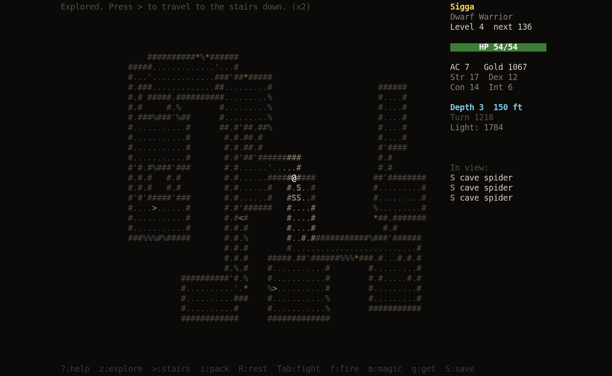

# Orrundeep

**A classic ASCII dungeon descent. Plays in the browser, no install.**

### ▶ [Play it now](https://andreasmaeleng.github.io/orrundeep/)



Two hundred years ago the dwarves of Orrun dug too greedily beneath the sea, and the sea came in.
Their king would not leave his hall. He is down there still: twenty levels and a thousand feet
below the Gate, wearing a crown of drowned gold.

Go down. Bring it back. Try not to die on the stairs.

## What it is

Orrundeep is an original roguelike in the tradition of the 1980s dungeon-descent games: a town on
the surface with shops, a deep mine below it, and one very bad king at the bottom.

- **Permadeath**, 20 levels, a final boss, and a second win condition: carry the crown back up.
- **4 peoples × 4 callings**: Human, Dwarf, Elf, Halfling; Warrior, Rogue, Ranger, Mage (12 spells).
- **59 creatures** with their own tricks: worms that multiply, thieves that vanish with your gold,
  ghosts that walk through walls, drakes that breathe, liches that raise the dead, four named uniques.
- **Unidentified items**: potions, scrolls, wands and rings are shuffled every game.
- **Mineral veins** you can tunnel for gold, rubble to clear, traps to spot and disarm.
- **Light matters**: torches burn down. Lanterns need oil. The dark is how most people die.
- **Town with four shops**, and Scrolls of Homeward to get back to them.
- **Modern comforts**: auto-explore (`z`), travel to stairs (`>`), one-key fighting (`Tab`),
  click-to-travel, a creature list, hover-to-look.
- **Seeded runs**: every game has a seed; `?seed=anything` plays the same dungeon. There is a daily seed.
- **Shareable morgue**: when you die you get a text obituary to copy and post.

## What it is not

No ads, no tracking, no account, no network requests. Two files of plain JavaScript, no
dependencies, no build step. Your save lives in your browser's local storage.

## Keys

| | |
|---|---|
| Move | arrows, numpad, or `hjklyubn`; Shift + direction runs |
| `z` | auto-explore |
| `>` `<` | take stairs, or travel to them |
| `Tab` | fight the nearest enemy |
| `i` `e` | pack, equipment |
| `w` `q` `r` `E` | wield/wear, quaff, read, eat |
| `f` `v` `a` `m` | fire, throw, aim wand, cast |
| `R` `s` | rest, search |
| `T` `D` `c` | tunnel, disarm, close door |
| `x` `C` `M` `?` | look, character, messages, help |
| `S` | save and quit |

## Run it locally

```sh
git clone https://github.com/andreasmaeleng/orrundeep
cd orrundeep
python3 -m http.server   # then open http://localhost:8000
```

Or just open `index.html`.

## Tests

The engine (`game.js`) has no DOM in it, so bots can play it headlessly:

```sh
node test/bot.js 40 6000    # chaos bots: random valid actions, save/load round-trips
node test/deep.js 12        # over-powered bots dive to the bottom, kill the king, carry the crown home
node test/smart.js 32       # a plain-sensible bot, to see how deep each class gets
```

## Licence

MIT. Fork it, mod it, add your own monsters.
